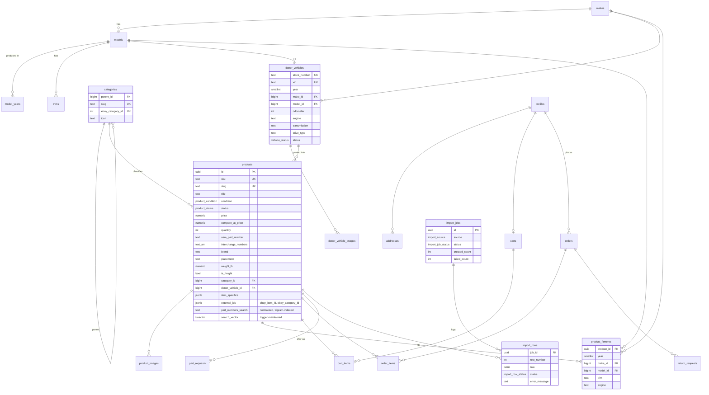

# Genuine Auto & Truck Parts: Build Plan

Online store for a Phoenix, AZ used/recycled OEM auto & truck parts dismantler.
Reference: garagemanstore.com. We match its structure, then go further on search, fitment, data quality and speed.

Stack: Next.js 16 (App Router, Cache Components, Turbopack) · TypeScript strict · Supabase (Postgres, Auth, Storage, RLS) · Tailwind v4 + shadcn/ui conventions · Zod · React Hook Form · GSAP (lazy, decorative only).

---

## 1. Reference analysis

**What garagemanstore.com does (keep):** utility bar + flat nav (Home, Parts, Vehicles, Airbags, About, Sell My Car, Returns, Contact); hero with two CTAs and a 4-stat strip; trust badges; Shop by Make; Shop by Category; "Fresh off the lift" carousel; "Currently Dismantling" donor-vehicle cards (Stock #, odometer, engine, transmission, drive, color, View Parts); We Buy Used Cars; quality standard; reviews; email signup; Year/Make/Model/Part Type facets on search; 6-month warranty and 30-day returns policy pages.

**Weak points we fix:**

| Theirs | Ours |
| --- | --- |
| "Only 1 left" and "Sold out" on the same card; duplicated "Regular price Sale price" label | One stock badge driven by `status` + `quantity`; compare-at price only when it's higher |
| No condition, SKU, part # or fitment on cards | Condition, placement and OEM # on every card |
| Part number buried in title; no part-number search | Structured `oem_part_number` + `interchange_numbers[]`, normalized part-number search (dashes/spaces ignored) |
| No VIN lookup, no condition/price facets, results capped at ~1000 | VIN decode (NHTSA vPIC), condition and price filters, unlimited paginated results with exact counts |
| Shipping cost hidden until checkout; vague claims ("5 Star Rated") with no proof | Shipping/warranty/returns on the product page; reviews only from the real Google listing |
| Policy pages copy-pasted from eBay/LKQ templates | Plain-language policies written for this business (to be confirmed by owner) |
| Hidden request forms duplicated 8× on the homepage | One "Request a part / Make an offer" flow |

---

## 2. Sitemap

```
/                          Home
/parts                     Listing + advanced search (all filters in URL)
/parts/[slug]              Product detail
/vehicles                  Currently dismantling
/vehicles/[slug]           Donor vehicle + its parts (→ /parts?vehicle=STOCK#)
/sell-your-car             Sell-your-car form
/returns                   Return request form
/contact                   Contact / part request / fitment check (?topic=)
/about  /faq
/policies/{shipping,returns,warranty,privacy,terms}
/account  /cart  /checkout (Phase 3)
/admin/* (Phase 4)
/api/fitment/makes  /api/fitment/models  /api/vin/[vin]
/sitemap.xml  /robots.txt  /opengraph-image
```

Status: **built** = every route above except /checkout. That covers home, /parts, /parts/[slug], /vehicles, /vehicles/[slug], /sell-your-car, /returns, /contact, /about, /faq and /policies/* (draft copy), the customer account pages (/account, /account/login, /account/signup, /account/forgot-password, /account/reset-password, /auth/confirm) and /cart (cookie cart with an order request until Stripe), plus /admin/*, the APIs and the SEO routes.

---

## 3. Design system

- **Colors** (CSS variables in `src/app/globals.css`, exposed as Tailwind tokens; no hex values in components):
  brand red `#C01426` (sampled from the logo), strong red `#9E0F1F`, bright red `#EF3B48` for red text on black, ink `#0B0B0C`.
  Semantic tokens follow shadcn naming (`primary`, `muted`, `accent`, …) plus `inverse-*` for black surfaces.
  All text pairs meet WCAG AA (body text ≥ 4.5:1).
- **Type:** Barlow Condensed (display, uppercase, industrial) + Geist (body), via `next/font`.
- **Logo:** `public/brand/logo-original.jpg` (source), `logo.png` (dark text, transparent), `logo-light.png` (white text for black surfaces), `icon-512.png` → favicon/app icons. OG image generated at `/opengraph-image`.
- **Motion budget:** CSS-first (speed lines from the logo's streaks, fade-up). The hero wheel (brand/hero-wheel.tsx: tire, twin-spoke rim, drilled disc, fixed caliper) rolls via CSS from first paint, then a small rAF loop adds scroll momentum with friction. GSAP is dynamically imported after hydration for the hero stat count-up. Everything respects `prefers-reduced-motion`. No animation on the LCP headline, and nothing starts hidden in the server HTML.
- **Performance targets:** Lighthouse ≥ 95 (Perf/A11y/SEO), LCP < 2.0s on 4G, CLS < 0.05, < 120 KB JS on home.

---

## 4. Components

```
components/
  brand/       Logo, GearMark
  layout/      SiteHeader, HeaderSearch (quick search + "Shop by vehicle" toggle), MainNav, MobileMenu, SiteFooter, PagePlaceholder
  search/      VehicleSearch (segmented Year → Make → Model → Part bar + My Vehicle; keyword/OEM # stays in the header),
               FacetSidebar, ActiveFilters, SortSelect, Pagination, garage (cookie helpers)
  catalog/     ProductCard, ProductGrid (+Skeleton, EmptyState), VehicleCard, PartImage (branded fallback), CategoryIcon
  home/        Hero, TrustPoints, ShopByMake, ShopByCategory, NewestArrivals, CurrentlyDismantling,
               SellCarCta, QualityStandard, Reviews, Newsletter, Section
  motion/      HeroMotion (lazy GSAP), Reveal (IntersectionObserver)
  ui/          Button, Input, NativeSelect, Label, Badge, Skeleton, Slot   (shadcn conventions; components.json present)
  section-boundary.tsx   per-section error boundary (next/error catchError)
```

Phase 2 adds: Gallery (zoom/lightbox), FitmentChecker, OfferForm, SellCarForm, ReturnForm, ContactForm (React Hook Form + Zod + Server Actions), Breadcrumbs, VehicleSpecs.

---

## 5. Database schema

Migrations: `supabase/migrations/` (also concatenated into `supabase/setup.sql` for the SQL Editor). Verified locally with `npm run db:verify` (PGlite, 18 checks incl. RLS).



Also: `profiles` (1:1 `auth.users`, role customer/staff/admin), `addresses`, `carts`, `cart_items`, `orders` (Stripe ids, `GA-100001` numbers), `order_items` (price snapshot), leads (`sell_car_requests`, `part_requests`, `return_requests`, `contact_messages`, `newsletter_subscribers`).

**Key decisions**
- Fitment is one row per year (not ranges): simple equality filters, index-friendly `(make_id, model_id, year)`. The 6,511 listings produce ~27k rows.
- `search_vector` is maintained by trigger (title A, OEM/part numbers A, interchange B, category + fitment make/model B, brand C, description D). Fitment changes re-index the parent product via a statement-level trigger, so bulk imports re-index once per statement.
- `part_numbers_search` stores normalized OEM + interchange numbers + compacted title, so "92401-J5000", "92401 J5000" and "92401J5000" all match.
- **RLS:** public reads active + sold products (sold stay visible for SEO with a "Sold out" badge); drafts hidden. Leads are insert-only for anon, and server actions must not chain `.select()` after insert. Every write table has staff policies via `is_staff()` (security definer). Customers own their carts, addresses and orders. Role changes are blocked by trigger.
- Storage buckets `product-images` and `vehicle-images`: public read, staff write.

---

## 6. Search architecture

```
AdvancedSearch (client) ──► /parts?year=&make=&model=&category=&q=&pn=&condition=&min=&max=&stock=1&sort=&page=
   │  Year → /api/fitment/makes?year → /api/fitment/models?make&year   (only combos with active stock, cached 1h)
   │  VIN  → /api/vin/[vin] → NHTSA vPIC (cached forever) → mapped to our make/model slugs
   │  My Garage cookie (gatp_garage, 1 year) pre-fills Y/M/M everywhere
   ▼
/parts (Server Component, params parsed by Zod in src/lib/search/params.ts)
   └─ searchParts() "use cache" (5 min, tag "catalog")
        ├─ rpc search_products(...)  .select(card fields + images) .range() count=exact
        └─ rpc search_facets(...)    categories / makes / conditions / price range
```

- `search_product_ids()` is one inlinable SQL SELECT: `websearch_to_tsquery` on the tsvector, OR `word_similarity` (pg_trgm) on title, OR normalized part-number `LIKE` on a trigram GIN index; plus fitment `EXISTS`, category subtree (recursive CTE), price, condition, stock and donor-vehicle filters.
- Ranking: `ts_rank_cd × 2 + word_similarity + 3 for a part-number hit`; in-stock items first. Sorts: relevance, newest, price ↑/↓.
- Facets are disjunctive: each facet ignores its own filter so siblings stay visible.
- Works without JS: the forms are plain GET to /parts, and the facets are links.
- Scale path (>100k parts): materialize `fitment_index (year, make, model, count)` refreshed after imports; consider `pg_search`/Typesense only if p95 > 150 ms.

---

## 7. eBay CSV mapping

### Real file in the repo: Seller Hub "All active listings" report (30 columns, 6,511 rows)

| eBay column | → field | Notes |
| --- | --- | --- |
| Item number | `external_ids.ebay_item_id` | Fallback SKU `EBAY-<item>` if Custom label is empty (1 row) |
| Title | `title`, `slug` | Slug = title + first 8 chars of SKU |
| Custom label (SKU) | `sku` (upsert key) | GUIDs in this account |
| Available quantity | `quantity`; 0 ⇒ `status = sold` | |
| Current price | `price` | Start price ignored (all FIXED_PRICE) |
| Currency | `currency` | All USD |
| Start date | `listed_at` | "Jul-18-25 00:12:28 PDT" → ISO |
| eBay category 1 name/number | child `categories` row (`ebay_category_id`) under one of 14 storefront groups | 202 eBay categories → keyword rules + overrides in `src/lib/import/category-groups.ts` |
| Condition | `condition` | Used/USED → used, New → new, plus ConditionID map |
| *(title)* | `product_fitments`, `oem_part_number`, `interchange_numbers`, `placement`, engine, trim | `src/lib/import/title-parser.ts` |
| Format, Sold quantity, Watchers, Bids, End date, CD:*, P:UPC/EAN/ISBN, ePID, Listing site | ignored | Trading-card / auction fields, all empty |

**Parse quality on the real file (imported 2026-11-19):** 6,511 rows imported, 0 failed · years 99.7% · make 99.8% · model 98.9% · OEM part # 67.3% · 27,732 fitment rows.

**Important gap:** this report has **no pictures, item specifics, descriptions or compatibility tables.** Options for images, best first:
1. Export the **File Exchange / Seller Hub "Download listings" template** (has `PicURL`, `C:Brand`, `C:Manufacturer Part Number`, `C:Interchange Part Number`, `Compatibility`). The column map is already in `EBAY_COLUMNS.ebay_file_exchange`; it needs a real sample before the mapper is switched on.
2. **eBay Browse API** `getItemByLegacyId` per item number (needs an eBay developer app key). Pulls images + item specifics, ~6.5k calls.
3. Upload photos manually per SKU in the admin (Phase 4).

### Photos via the eBay API → Cloudflare R2 (planned, not built)

Every product already stores `external_ids.ebay_item_id`, so images can be pulled per listing.

**Storage choice:** Cloudflare **R2** (S3-compatible, no egress fees), a public bucket served from a custom domain such as `img.<yourdomain>.com` through Cloudflare's CDN. Supabase Storage remains possible behind the same interface.

**Storage interface** (`src/lib/storage/`): one module boundary, so the provider can be switched without touching callers:

```ts
export interface ImageStore {
  put(key: string, body: Uint8Array, opts: { contentType: string; cacheControl?: string }): Promise<void>;
  delete(keys: string[]): Promise<void>;
  exists(key: string): Promise<boolean>;
  publicUrl(key: string): string;            // CDN URL for a stored key
}
// r2-store.ts       → @aws-sdk/client-s3 with endpoint https://<ACCOUNT_ID>.r2.cloudflarestorage.com, region "auto"
// supabase-store.ts → current Supabase Storage bucket (fallback / dev)
// index.ts          → picks the implementation from IMAGE_STORE=r2|supabase
```

- `product_images.storage_path` keeps the **provider-neutral key** (e.g. `products/<sku>/1`). Rendering uses `imageUrl()` → `ImageStore.publicUrl()`, so switching providers changes one env var, not the data.
- **Variants:** every photo is converted with `sharp` to WebP at **max 1600px** (`…/1-1600.webp`, q≈80) plus a **thumbnail** (`…/1-400.webp`, q≈75). Width and height are stored on `product_images` (no layout shift).
- **Delivery:** since the variants are pre-built, `next/image` uses a small **custom loader** that picks `-400` or `-1600` from the requested width. Images are served straight from the CDN, with no Vercel image-optimization cost. Headers: `Cache-Control: public, max-age=31536000, immutable` (keys are versioned on re-upload).

**Script:** `scripts/fetch-ebay-images.ts` (`npm run images:ebay -- [--limit N] [--dry-run] [--max-per-product 6] [--specifics]`)

1. **Auth:** eBay OAuth *client-credentials* (application) token: `POST https://api.ebay.com/identity/v1/oauth2/token`, `grant_type=client_credentials`, scope `https://api.ebay.com/oauth/api_scope`, Basic auth `ClientID:ClientSecret`. The token lives 2 hours; refresh on 401.
2. **Select work:** active products with `source = 'ebay'`, an `ebay_item_id` and no `product_images` rows. Resumable.
3. **Fetch:** Browse API `GET /buy/browse/v1/item/get_item_by_legacy_id?legacy_item_id=<id>` (`X-EBAY-C-MARKETPLACE-ID: EBAY_US`). Use `image.imageUrl` + `additionalImages[]`, rewriting to `s-l1600.jpg`. Concurrency 4, exponential backoff on 429/5xx, and a daily call budget so the script stops cleanly at the quota.
4. **Process:** download, then `sharp`: auto-rotate, strip metadata, resize to 1600 and 400, encode WebP.
5. **Store:** `ImageStore.put()` both variants, then insert `product_images (storage_path = key, alt = "<title> – photo n", position, width, height)`.
6. **Bonus (`--specifics`):** `localizedAspects` (Brand, Manufacturer Part Number, Interchange Part Number, Placement) → `brand`, `oem_part_number`, `interchange_numbers`, `item_specifics`. That's more reliable than title parsing. `shortDescription` → `description`.
7. **Log:** an `import_jobs` row (new enum value `ebay_api`) + per-item `import_rows`, then `POST /api/revalidate`.

**What you need**

| Item | Where | Env |
| --- | --- | --- |
| eBay developer account + **production keyset** (App ID / Client ID, Cert ID / Client Secret) | developer.ebay.com → Application Keys | `EBAY_CLIENT_ID`, `EBAY_CLIENT_SECRET` |
| Marketplace Account Deletion compliance (choose the exemption: we don't store eBay user data) | developer portal → Alerts & Notifications | none |
| Browse API quota: 5,000 calls/day by default, so 6,511 items ≈ 2 days (or request more via Application Growth Check) | eBay | none |
| Cloudflare account + **R2 bucket** (e.g. `genuine-auto-images`) | Cloudflare → R2 | `R2_ACCOUNT_ID`, `R2_BUCKET` |
| R2 **API token** with Object Read & Write on that bucket | R2 → Manage API tokens | `R2_ACCESS_KEY_ID`, `R2_SECRET_ACCESS_KEY` |
| **Custom domain** connected to the bucket (requires the domain on Cloudflare DNS) | R2 bucket → Settings → Public access | `NEXT_PUBLIC_IMAGE_BASE_URL=https://img.<domain>` |
| Confirmation that listing photos are the seller's own (not stock photos) | Client | none |

**Cost estimate:** ~6.5k items × ~4 photos × (≈120 KB + ≈25 KB) ≈ **3.8 GB**. R2 storage is about $0.015/GB-month (first 10 GB free) with free egress, so effectively free at this size.

Fallbacks: the Trading API `GetItem` (needs a seller *user* token; works for ended listings), or a File Exchange export with `PicURL` (no API needed; same processing pipeline).

### Import pipeline (`npm run import:ebay -- <file> [--commit] [--mark-missing-sold]`)
detect format → Zod-validate each row → map → sync makes/models/category tree → upsert products by SKU (batches of 250) → rebuild fitments → log every row to `import_rows` (status, warnings, raw jsonb) → finish `import_jobs` counts. `--mark-missing-sold` marks eBay products absent from a fresh report as sold. Dry run by default; writes `data/reports/*.parsed.json`.

### Export (Phase 4)
`/admin/export?format=ebay_file_exchange` streams CSV with the same headers (Action=Revise, ItemID, CustomLabel, Title, StartPrice, Quantity, ConditionID, Category, PicURL joined with `|`, C:* specifics from `item_specifics`, Compatibility from fitments).

---

## 8. Folder structure

```
src/
  app/                 routes (see sitemap), actions/, api/, layout, globals.css, SEO files
  components/          see §4
  config/site.ts       nav, footer, cookie names
  content/business.ts  name, address, phone, hours, reviews, policies  (⚠ placeholders to fill)
  lib/
    catalog/           cached queries ("use cache" + cacheTag "catalog"), types, image URLs
    import/            eBay mapping, category groups, vehicle reference, title parser
    search/params.ts   URL contract (Zod) + partsHref()
    seo/json-ld.tsx    AutoPartsStore, WebSite, Product
    supabase/          public (cookie-less, cache-safe), server (cookies), browser clients, database.types
    vin/decode.ts      NHTSA vPIC
scripts/               import-ebay.ts, generate-seed.ts, verify-migrations.ts, apply-migrations.ts
supabase/              migrations/, seed.sql, setup.sql
data/imports/          eBay CSVs (git-ignored)
public/brand/          logo assets
```

---

## 9. Roadmap

**Phase 1: Foundation ✅ (this session)**
Scaffold, tokens, logo, layout/header/footer, schema + RLS + search SQL, eBay mapper + importer, seed, homepage, /parts, product page, SEO/JSON-LD, lint/typecheck/build green.

**Phase 2: Catalog & content** (in progress)
- ✅ Full eBay import live in Supabase (6,511 products).
- ✅ Resilient data layer: failed queries log, fall back to empty states and cache for minutes only; product and vehicle pages render on demand (no build-time generation) and are cached per URL; `/api/revalidate` refreshes the catalog after imports.
- ✅ Vehicles list + detail, Sell Your Car, Returns, Contact (topics: general / part request & offer / fitment / order) with RHF + Zod + Server Actions → leads tables; spam protection = honeypot + time trap + Postgres rate limit on salted IP hashes (migration `…000300`).
- ✅ Shipping rules as config (`src/content/shipping.ts`: flat / weight tiers / free-over-threshold + freight flag), shown as "calculated at checkout" until confirmed.
- Product gallery (zoom, swipe), "Check fitment" helper (uses My Garage + VIN), offer/part-request form.
- /vehicles + /vehicles/[slug]; donor vehicle admin entry.
- ✅ Lead email alerts via Resend (branded HTML, product link for part requests/offers, sent with `after()`; failures only log).
- ✅ Real 404 status for unknown `/parts/*`, `/vehicles/*`, `/policies/*` (Proxy existence check; Cache Components always streams pages with 200).
- ✅ About, FAQ (FAQPage JSON-LD) and 5 policy pages as **DRAFT** copy driven by config values.
- Real policy pages, About, FAQ (FAQPage JSON-LD).
- Images: File Exchange export or Browse API → download into Storage (`products/<sku>/<n>.webp`), `product_images`.
- Business details + reviews from the Google listing.

**Phase 4 preview ✅:** `/admin/leads` (filter by type/status; New / Contacted / Closed / Spam) and `/admin/products` (search, edit price/qty/status, mark sold). Supabase Auth email+password; Proxy gate + `requireStaff()`/`checkStaff()` on every page and Server Action + RLS `is_staff()` at the database.

**Phase 3: Cart & checkout** (detailed design in §11)
*Needed from the client:* Stripe account (business verified, bank account for payouts) and API keys (`STRIPE_SECRET_KEY`, `NEXT_PUBLIC_STRIPE_PUBLISHABLE_KEY`, `STRIPE_WEBHOOK_SECRET`); confirmed shipping strategy + rates (`src/content/shipping.ts`) and which parts are freight; sales-tax approach (Stripe Tax registration for AZ, plus states where they have nexus); final warranty/returns/terms copy; order email sender domain verified in Resend; how inventory syncs with eBay so a part can't sell twice (we'd mark sold on our side and end the eBay listing, or re-import often with `--mark-missing-sold`).

Guest cart in a signed cookie, merged into `carts` on login · Stripe Checkout Sessions (shipping rates by weight/freight flag, Stripe Tax for AZ) · webhook creates `orders`/`order_items` with the service role and decrements quantity atomically (`update … where quantity >= n`) · Supabase Auth (magic link + Google) · order history · transactional emails.

**Phase 4: Admin & import UI**
`/admin` behind `is_staff()`: products CRUD with image upload (drag-drop → Storage), donor vehicles, leads inbox with statuses, orders. CSV upload UI (stream to Storage → background job → live `import_rows` progress, retry failed rows) and CSV export in eBay File Exchange format. `revalidateTag("catalog")` after every write.

**Phase 5: SEO & performance**
Make/model landing pages (`/parts/bmw/3-series`), category pages, sitemap index (`generateSitemaps`), breadcrumbs JSON-LD, Search Console, Lighthouse CI budgets, image CDN tuning, Vercel Analytics / Speed Insights. (Done early: `catalog_summary` precomputes category counts, unfiltered facets and stats; migration 0500.)

---

## 10. Open questions for the owner

1. Real business details from Google: street, ZIP, phone, email, hours, rating, 3–6 reviews (paste into `src/content/business.ts`).
2. Warranty length (currently 90 days) and return window (30 days): confirm. The reference uses 6 months.
3. Can you export the **File Exchange / "Download listings" CSV** (with PicURL)? Otherwise, do we have eBay API access?
4. Shipping: flat rate, calculated by weight, or free? Which parts are freight-only (engines, transmissions, doors)?
5. Should sold eBay items stay visible as "Sold out" (good for SEO) or be hidden?
6. Do you want official make logos on "Shop by Make"? They're trademarks, so we currently use typographic tiles.

---

## 11. Phase 3 design: checkout, eBay sync, shipping & tax (plan only)

Goal: a one-of-one used part can never be sold twice, whether on the site, on eBay, or both at once, and every failure either retries safely or shows up in `/admin`.

### 11.1 Inventory reservation (the core rule)

Postgres is the single source of truth for "can this unit be sold". Stripe and eBay are told afterwards.

New migration (`0600_checkout.sql`):

```sql
create table public.inventory_holds (
  id                 uuid primary key default gen_random_uuid(),
  product_id         uuid not null references public.products (id) on delete cascade,
  quantity           integer not null check (quantity > 0),
  checkout_session   text unique,             -- Stripe Checkout Session id (set after creation)
  order_id           uuid references public.orders (id) on delete set null,
  status             text not null default 'held' check (status in ('held', 'converted', 'released')),
  expires_at         timestamptz not null,    -- now() + 30 min (matches Stripe session expiry)
  created_at         timestamptz not null default now()
);
create index on public.inventory_holds (product_id) where status = 'held';
-- RLS on, no policies: only security-definer functions / service role touch it.
```

- `reserve_items(p_items jsonb, p_ttl interval) returns uuid[]`: security definer, one transaction.
  - Lock the product rows: `select … for update`, ordered by id to avoid deadlocks.
  - Check `quantity - active holds >= requested` and `status = 'active'` for every item, or raise `insufficient_stock` naming the SKU.
  - Insert the holds.
  - The second buyer of the same unit blocks on the row lock, then fails cleanly.
- `available_quantity` = `quantity - sum(active holds)`. Product cards and the PDP read it, so a held part shows "In someone's cart, check back in 30 min" instead of a Buy button.
- `convert_holds(p_session text, p_order uuid)`:
  - Marks the holds `converted`.
  - Decrements quantity with `update products set quantity = quantity - n where id = … and quantity >= n`.
  - Sets `status = 'sold'` at 0.
  - Is idempotent: already-converted holds are a no-op.
- `release_expired_holds()`: run by `pg_cron` every 5 minutes and on `checkout.session.expired`. It marks stale `held` rows `released`.

### 11.2 Stripe Checkout + webhook flow

1. **Cart → `POST` Server Action `startCheckout`:**
   - Validate the cart (Zod) and re-read prices server-side; never trust the client.
   - Call `reserve_items`. On `insufficient_stock`, return "This part just sold" with similar parts.
   - Create a `pending` order and its `order_items` (snapshotting title, SKU and price).
   - Create the Stripe Checkout Session:
     - `mode: payment` and line items from DB prices.
     - `expires_at` = hold expiry (Stripe minimum is 30 min).
     - `metadata: { order_id }` and `client_reference_id`.
     - `shipping_options` from §11.4 and `automatic_tax` from §11.5.
     - `idempotency_key` = order id.
   - Store `checkout_session` on the holds and order, then redirect to `session.url`.
   - If Stripe errors, release the holds and mark the order `cancelled`.
2. **`POST /api/stripe/webhook`** (Node runtime, raw body, `stripe.webhooks.constructEvent` with `STRIPE_WEBHOOK_SECRET`):
   - `checkout.session.completed` (and `async_payment_succeeded`) → in one RPC `finalize_order(session)`:
     - Set the order `paid`.
     - Copy the amounts and addresses Stripe calculated (shipping, tax, total).
     - `convert_holds`.
     - Write `stripe_payment_intent_id`.
     - Then `revalidateTag("catalog")`, enqueue the eBay sync jobs (§11.3), and send emails in `after()`.
   - `checkout.session.expired` / `async_payment_failed` → release holds, order `cancelled`.
   - `charge.refunded` → order `refunded`. Restocking is a manual admin choice, because a returned used part needs inspection.
   - **Idempotency:** a `stripe_events (id text primary key, type, received_at, processed_at, error)` table. Insert the event id first and skip duplicates. Return 2xx only after the DB work commits, so Stripe retries on failure (it retries for 3 days).
   - **Paid but the part is already gone:** the hold makes this impossible unless an admin edited stock mid-checkout. If `convert_holds` finds `quantity < n`:
     - Mark the order `processing` with a `needs_attention` flag.
     - Alert staff by email.
     - Staff refund from `/admin/orders`. Auto-refund is optional, behind a config flag.
3. **Success page** `/checkout/success?session_id=…`:
   - Reads the order by session id.
   - Shows "Payment received, confirming…" until the webhook marks it paid.
   - Never fulfils from the redirect.
4. **Order emails (Resend, reusing `src/lib/email`):**
   - Customer: order confirmation (items, totals, shipping or freight note, policy links) and later shipped with tracking.
   - Staff: a new-order alert to `LEADS_NOTIFY_EMAIL`.
   - Sent in `after()`, failures are logged to `email_log` and never affect the order. The sender comes from `RESEND_FROM` on the verified domain.
5. **Accounts:** guest checkout by default. Stripe collects the email, and orders link to a profile when the email matches a signed-in customer. Magic-link sign-in adds order history.

### 11.3 eBay sync (production keyset)

The client supplies the eBay production keyset (App ID, Cert ID, Dev ID) and a user refresh token granted with the `sell.inventory` scope. The listings are classic Seller Hub listings, not Inventory API items, so:

- **End or zero the listing on site sale:**
  - Default: Trading API `ReviseInventoryStatus` (Quantity 0), using the ItemID from `products.external_ids.ebay_item_id`. This keeps the listing's history and lets "out of stock" control hide it.
  - Fallback: `EndFixedPriceItem` (reason `NotAvailable`) when quantity control isn't enabled.
  - The OAuth token is refreshed with the refresh token and cached in the DB with its expiry.
- **Outbox pattern:**
  - The webhook doesn't call eBay inline. `finalize_order` inserts `sync_jobs (id, kind 'ebay_end_listing', product_id, item_id, status 'pending'|'running'|'done'|'failed'|'dead', attempts, next_attempt_at, last_error, created_at, updated_at)` in the same transaction as the sale, so a sale without a sync job can't exist.
  - Admin "mark sold" enqueues the same job.
- **Worker:** `/api/cron/sync` (Vercel Cron every minute, Bearer `CRON_SECRET`).
  - Claims due jobs with `for update skip locked`.
  - Calls eBay and marks the job `done`.
  - On failure: `attempts++`, exponential backoff with jitter (1m, 2m, 5m, 15m, 1h, 3h), and `last_error` stores the eBay error code and message.
  - After 8 attempts the job is `dead` and staff get an email.
  - Non-retryable eBay errors (listing already ended, item not found) count as success with a note.
- **eBay sale while a site checkout is open:** handled by the scheduled re-import below, which marks the part `sold`.
  - Any open hold then fails at `convert_holds`. That is the "paid but gone" path in §11.2, rare and surfaced to staff.
  - Later (optional): eBay Platform Notifications (`ItemSold` / `FixedPriceTransaction`) to `/api/ebay/notify` with signature verification, for near-real-time updates.
- **Scheduled re-imports:**
  - `import:ebay --commit --mark-missing-sold`, with the active-listings report pulled via the Sell Feed API (`LMS_ACTIVE_INVENTORY_REPORT`).
  - Runs on a GitHub Actions or Vercel cron every 2–4 hours.
  - Its own job row in `import_jobs`. It refreshes `catalog_summary` and revalidates at the end (already built).
  - Retries the whole run 3× with backoff. A failed run leaves the previous data untouched: rows upsert, and mark-missing-sold runs only after a fully successful parse with a row count within ±20% of the last run, which guards against a truncated report selling out the catalog.
- **`/admin/sync`:**
  - Tabs: Failed / Dead / Pending / Done (24h).
  - Each row: SKU, eBay ItemID (linked), attempts, last error, next attempt.
  - Actions: Retry now, Mark resolved (ended manually on eBay), Open product.
  - Header badges: last successful re-import time and the dead-job count, also shown on the admin nav.
  - Server-side staff checks, like the other admin actions.

### 11.4 Shipping hook (driven by `src/content/shipping.ts`)

- `quoteShipping(items)` already returns `quote | freight | unconfirmed`. Checkout maps it like this:
  - `quote` → one Stripe `shipping_options` entry (`fixed_amount`, display name "Standard", delivery estimate from `handlingTime`).
  - `freight` (any item with `is_freight`) → checkout is blocked for that cart and the CTA becomes "Request freight quote" (a part request with the SKUs). Option for later: a "Freight: we'll invoice" $0 line plus a manual follow-up, if the client prefers.
  - `unconfirmed` (`confirmed: false`) → checkout stays disabled site-wide with a clear message. Flipping `confirmed: true` turns it on with no code change.
- Local pickup is an optional second `shipping_options` entry ($0) when `business.address` is confirmed.

### 11.5 Tax hook (Stripe Tax)

- New config `src/content/tax.ts`: `{ mode: "off" | "stripe_tax", productTaxCode: "txcd_99999999" /* general tangible goods */, shippingTaxCode: "txcd_92010001" }`.
- `stripe_tax` → `automatic_tax: { enabled: true }`. Line items use `tax_behavior: "exclusive"` and the product tax code, and shipping options use the shipping tax code. Stripe calculates from the shipping address, and the webhook stores `total_details.amount_tax` in `orders.tax_total`.
- Registrations (Arizona TPT plus any economic-nexus states) are managed in the Stripe dashboard, not in code. Until set, `mode: "off"`.
- Core charges, if the client uses them: a separate line item, non-taxable code, refundable on core return. This needs the client's decision.

### 11.6 Env vars (Phase 3)

`STRIPE_SECRET_KEY`, `NEXT_PUBLIC_STRIPE_PUBLISHABLE_KEY`, `STRIPE_WEBHOOK_SECRET`, `CRON_SECRET`, `EBAY_APP_ID`, `EBAY_CERT_ID`, `EBAY_DEV_ID`, `EBAY_REFRESH_TOKEN`, `EBAY_ENV=production`, plus the existing `RESEND_*`.

### 11.7 Tests before launch

- Two concurrent `reserve_items` for the same unit: exactly one succeeds (PGlite plus a live staging check).
- Webhook replay of the same event: no double decrement.
- Expired session: holds released.
- eBay job failure: retries, then `dead`, then shows in `/admin/sync`.
- Stripe CLI `stripe trigger checkout.session.completed` against a preview deploy.

---

## 12. Admin dashboard

Goal: `/admin` is where staff run the whole business (catalog, orders, leads, vehicles, customers, content, settings) without touching code or the SQL Editor.

### 12.1 What exists today (2026-11-20)

| Area | State |
| --- | --- |
| Auth | `/admin/login` (password + rate limit). `checkStaff()` / `requireStaff()` verify the JWT (`getClaims`) and read `profiles.role`, used by both pages and actions. Proxy refreshes the session on `/admin/*`. |
| Roles | `user_role` enum: `customer` / `staff` / `admin`. `is_staff()` (staff **or** admin) backs every write policy. There's no admin-only check, and staff can change roles. |
| Leads | `/admin/leads` lists 4 lead tables (200 per type, merged in memory) with a status select. There's no detail view, notes, assignee or pagination. |
| Products | `/admin/products`: search (title/SKU/OEM/part #), status filter, 50 per page, inline price/qty/status, mark sold. Refreshes `catalog_summary` and revalidates `catalog` + `product:<slug>`. |
| Missing | Orders, vehicles, customers, imports UI, images, content, settings, audit log, dashboard. The cart's "Send order request" is saved as a **part_requests lead**, not an order. |
| Data | 6,511 products, 0 product images, 3 donor vehicles (demo), 0 orders, 0 leads, 4 import jobs / 13,022 import rows, **0 profiles: no admin user exists yet**. |
| DB access | No `SUPABASE_DB_URL`: schema changes are pasted into the SQL Editor. `npm run db:verify` checks migrations in PGlite. |
| Content | `src/content/{business,shipping,reviews}.ts` + JSX in FAQ/policy pages, imported by 19 files. |

### 12.2 Access model

Every check runs on the server **and** again in Postgres (RLS). Hiding links is cosmetic only.

| Role | Can use |
| --- | --- |
| `admin` | Everything. |
| `staff` | Dashboard, Orders, Products, Vehicles, Leads, Customers (read + status updates), command palette. |
| `admin` only | Imports & Images, Content, Settings (staff & roles, notifications, flags), Activity Log, disabling customers, deleting products/orders. |

- `requireArea(area)` in every page, plus `authorize(area)` at the top of **every** Server Action and Route Handler. Signed out → `/admin/login?next=…`. Wrong role → `/admin/login?error=forbidden` with no data rendered.
- New SQL helper `is_admin()`. Admin-only tables (`site_settings` writes, `audit_log` reads, role changes) use it.
- `/admin/*` is `noindex` (metadata + `X-Robots-Tag` in Proxy), disallowed in robots.txt and absent from the sitemap. All admin reads are request-time (no `"use cache"`), so private data is never cached.

### 12.3 Sitemap and tables

| Route | Purpose | Tables |
| --- | --- | --- |
| `/admin` | Dashboard: KPIs, needs attention, recent activity, quick actions | products, orders, leads ×4, import_jobs, image_jobs, audit_log |
| `/admin/orders` · `/[id]` · `/[id]/packing-slip` | List (status tabs), detail (items, customer, address, notes, timeline, tracking + carrier), print slip | orders, order_items, order_events |
| `/admin/products` · `/new` · `/[id]` | Data table (filters, bulk actions, CSV export) and full editor (fields, SEO, fitment rows, images, duplicate) | products, product_fitments, product_images, categories, makes, models, storage `product-images` |
| `/admin/vehicles` · `/new` · `/[id]` | Donor vehicle CRUD, photos, linked parts | donor_vehicles, donor_vehicle_images, products, storage `vehicle-images` |
| `/admin/leads` · `/[type]/[id]` | List + detail: notes, assignee, reply link, convert part request → order | sell_car_requests, part_requests, return_requests, contact_messages |
| `/admin/customers` · `/[id]` | List, detail (orders, leads, saved vehicle), disable | profiles, orders, leads, auth (service role for ban) |
| `/admin/imports` · `/[id]` | Browser CSV upload (dry run → preview → commit), history, row errors, warnings CSV, image jobs + re-run | import_jobs, import_rows, image_jobs |
| `/admin/content` | Business info, homepage, reviews, FAQ, policies, warranty/returns/shipping | site_settings |
| `/admin/settings` | Staff & roles, notification emails, feature flags | profiles, site_settings |
| `/admin/activity` | Filterable audit log | audit_log |
| `/admin/api/search` · `/admin/api/products.csv` · `/admin/api/imports/[id]/warnings.csv` | Command palette search, CSV exports | products, orders, profiles, import_rows |

### 12.4 Schema changes (`supabase/migrations/20261120000600_admin.sql`)

The Phase 3 checkout migration becomes `0700`.

- `is_admin()`. The role-change guard becomes admin-only.
- **audit_log** (`actor_id`, `actor_email`, `action`, `entity_type`, `entity_id`, `before`, `after`, `created_at`). Written by a generic `security definer` trigger on products, orders, donor_vehicles, the lead tables, profiles and site_settings. Only changed columns are stored. Rows written by the service role (imports) are skipped, since import_jobs already records them. Admin read-only.
- **orders**:
  - `status` becomes `text` + check: `new, confirmed, paid, shipped, completed, cancelled, refunded`. Old values map `pending→new`, `processing→confirmed`, `delivered→completed`.
  - New columns: `source` (`request` | `stripe` | `manual` | `lead`), `customer_name`, `phone`, `carrier`, `shipped_at`, `staff_notes`, `deleted_at`.
  - **order_events** timeline (status changes, notes, tracking).
  - `create_order_request(...)`: a security-definer RPC the cart calls. It re-reads prices and stock from `products`, so the client can't set prices, and derives `customer_id` from `auth.uid()`.
- **products**: `seo_title`, `seo_description`, `deleted_at` (soft delete also sets `status = 'archived'`, so the public RLS already hides it), plus an admin list index.
- **leads** (×4): `assigned_to`, `internal_notes`, `updated_at`. `part_requests.order_id` records the conversion.
- **profiles**: `disabled_at`, `garage jsonb` (saved vehicle).
- **site_settings** (`key` pk, `value` jsonb, `updated_by`, `updated_at`). Keys: `business`, `policies`, `shipping`, `home`, `reviews`, `faq`, `policy_pages`, `notifications`, `flags`. Public read, admin write. The app merges each key over the file defaults in `src/content/*.ts`, so a missing row or table never breaks the site.
- **image_jobs** (`kind`, `status`, `total`, `done`, `failed`, `errors`, `created_by`). The first job type copies `product_images.external_url` into Storage.

### 12.5 How it's built

- **Layout:** collapsible sidebar (icon rail on desktop, drawer on mobile) in the black/white/red theme, built from shadcn-style primitives in `components/ui` and `components/admin`.
- **Tables:** server-side pagination, filters and sort in the URL, 300 ms debounced search, skeletons via Suspense. Products use exact counts on indexed filters. Make/model filters resolve through `product_fitments`.
- **Mutations:** Zod-validated Server Actions returning `{ ok, message }`, with Sonner toasts, `useOptimistic` for status changes, and confirm dialogs for destructive actions. Each one revalidates `catalog` / `product:<slug>` / `vehicle:<slug>` / `settings`, and calls `refresh_catalog_summary()` when catalog counts can change.
- **Command palette:** Ctrl/Cmd+K, static page list plus debounced `/admin/api/search` (products by title/SKU/OEM/eBay item #, orders by number/email, customers by name/email).
- **Settings on the public site:** `getSiteSettings()` is `"use cache"` + tag `settings`, merged over the file defaults. Feature flags: `checkoutEnabled` (cart order form), `showPrices` ("Call for price"), `maintenanceBanner` (site-wide notice).
- **Graceful before migration:** until 0600 is applied, admin pages that need new tables show a "run migration 0600" notice instead of crashing, and the public site keeps using the file defaults.
- **Tests:** Playwright (`tests/admin/*.spec.ts`, installed Chrome). Global setup creates throwaway admin / staff / customer users with the service role and deletes them afterwards. Coverage: every `/admin` route and action blocked for non-admins, product edit, order status update, CSV dry run, settings change visible on the public site.
